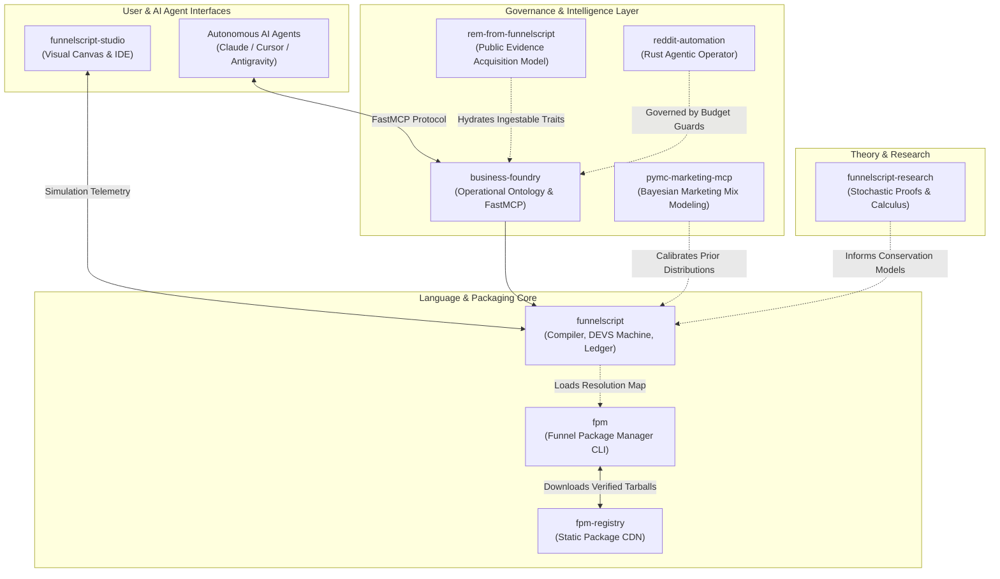

<div align="center">


# FunnelScript

### *Systems, expressed as code.*
**One language. Explicit states. Verifiable flows.**

[](https://github.com/funnelscript)
[](https://opensource.org/licenses/MIT)
[](https://github.com/funnelscript/funnelscript/tree/main/docs/brand)
[](https://github.com/funnelscript/funnelscript)

</div>

---

## 1. Overview

**FunnelScript** is an experimental domain-specific programming language, event-driven simulation runtime, and autonomous governance ecosystem designed to model, mathematically audit, and simulate complex business strategies, multi-channel marketing engines, and customer journeys as inspectable, verifiable code.

Traditional business planning relies on brittle spreadsheets, unvalidated assumptions, and fragmented dashboards. FunnelScript replaces this with:
- **Formal Discrete-Event Simulation (DEVS)**: Eliminates spreadsheet round-off errors and race conditions through rigorous event scheduling.
- **Strict Double-Entry Financial Conservation**: Invariant enforcement where $\sum \text{Debits} - \sum \text{Credits} = 0$ at integer minor-unit precision across every simulated tick.
- **Static Dimensional Typing**: Catches unit mismatches, time-scale errors, and invalid rate transitions at compile time.
- **Enterprise Governance for AI Agents**: Safe FastMCP protocol gateways, budget circuit breakers, and copy-on-write operational branching that prevent runaway agent behavior.

---

## 2. The FunnelScript Ecosystem

The FunnelScript platform is architected as a cohesive suite of specialized repositories:



### Complete Repository Directory

| Repository | Focus & Role | Technology Stack |
| :--- | :--- | :--- |
| **[`funnelscript/funnelscript`](https://github.com/funnelscript/funnelscript)** | **Core Language & Runtime**: AST parser, static linter, lowering pass, DEVS simulation engine, and double-entry ledger. | Python 3.12+, Hypothesis, Pytest |
| **[`funnelscript/funnelscript-studio`](https://github.com/funnelscript/funnelscript-studio)** | **Visual Studio**: Interactive node-graph canvas, real-time financial runway visualizer, and simulation IDE. | TypeScript, React, Vite, TailwindCSS |
| **[`funnelscript/business-foundry`](https://github.com/funnelscript/business-foundry)** | **Enterprise Governance Spine**: Operational Ontology, FastMCP Gateway, Metric Harmonizer, and Budget Circuit Breaker. | TypeScript, Bun, FastMCP, PostgreSQL |
| **[`funnelscript/fpm`](https://github.com/funnelscript/fpm)** | **Package Manager CLI**: Dependency resolution, deterministic lockfiles (`fpm.lock`), and SHA-256 verification. | Python 3.11+, UV, Click |
| **[`funnelscript/fpm-registry`](https://github.com/funnelscript/fpm-registry)** | **Static Package Registry**: Zero-server package repository and content-addressed archive hosted via GitHub Pages. | Static JSON, Tarball Archives, GitHub Pages |
| **[`funnelscript/rem-from-funnelscript`](https://github.com/funnelscript/rem-from-funnelscript)** | **Reverse Engineering Model**: Public evidence acquisition investigator, local web UI, and MCP server. | Go, SQLite, Local Web Server |
| **[`funnelscript/pymc-marketing-mcp`](https://github.com/funnelscript/pymc-marketing-mcp)** | **Bayesian MMM Server**: Statistically verified Model Context Protocol server for Marketing Mix Modeling. | Python, PyMC-Marketing, MCP |
| **[`funnelscript/reddit-automation`](https://github.com/funnelscript/reddit-automation)** | **Growth Operator**: Fast, local-first agentic operator with MCP support and budget governance. | Rust, Tokio, MCP |
| **[`funnelscript/funnelscript-research`](https://github.com/funnelscript/funnelscript-research)** | **Research & Theory**: Formal mathematical specifications, stochastic proofs, and architectural audits. | Markdown, LaTeX, Research Papers |

---

## 3. Brand Identity & Visual System

FunnelScript's identity reflects **mathematical precision, composed technical clarity, and verifiable execution**:

<div align="center">


### The Convergence Mark
*Three independent event streams converging onto an explicit, deterministic state node.*  
*It represents inspectable execution—not an abstract marketing gimmick.*

</div>

### Color Palette

| Token | Hex | Preview | Role |
| :--- | :---: | :---: | :--- |
| **Signal Violet** | `#725CFF` |  | Primary brand accent, convergence vectors, active states |
| **Accessible Violet** | `#6D54F5` |  | High-contrast text on light surfaces (WCAG AA compliant) |
| **Graphite** | `#121525` |  | Deep background, dark surfaces, terminal base |
| **Event Mint** | `#61E7C3` |  | Terminal output node, successful state transitions |
| **Cloud** | `#F6F7FB` |  | Light canvas surface, documentation contrast |

- **Typography**: Interface styled in **Inter Display**; code and vectors set in **IBM Plex Mono**.
- **Voice**: Precise, composed, technical, approachable.

---

## 4. Language Taste

A minimal FunnelScript world declaring pools, flows, double-entry financial posting, and capacity constraints:

```fnl
world HolisticOmnichannelScale {
    // 1. Stock / State Pools (Non-negative mass conservation)
    pool TopOfFunnel: 250_000 [visitors]
    pool CartCheckouts: 0 [orders]
    pool DeliveredOrders: 0 [orders]

    // 2. Double-Entry Financial Accounts (Integer Minor Units)
    account AdSpendExpense: USD 0.00
    account SettledCash: USD 150_000.00

    // 3. Rate-Driven Conversions with Attribution Metadata
    flow PaidAcquisition {
        from: TopOfFunnel
        to: CartCheckouts
        rate: 0.032
        channel: "meta_direct"
        
        // Atomic ledger posting on state entry
        post {
            debit: AdSpendExpense, USD 42.50
            credit: SettledCash, USD 42.50
        }
    }

    // 4. Capacity Guard: Physical warehouse pack limit per day
    guard WarehouseCapacity {
        target: CartCheckouts
        max_throughput: 1_200 [orders / day]
        on_breach: QueueSLA
    }
}
```

---

## 5. Getting Started

Clone the ecosystem tools or install via your preferred runtime:

```bash
# 1. Install FunnelScript core via UV
git clone https://github.com/funnelscript/funnelscript.git
cd funnelscript
uv sync

# 2. Run the Funnel Package Manager
fpm install --frozen

# 3. Launch the FastMCP Governance Gateway
cd ../business-foundry
bun run start
```

---

<div align="center">
<sub>Designed and engineered by the FunnelScript Authors. Distributed under the MIT License.</sub>
</div>
